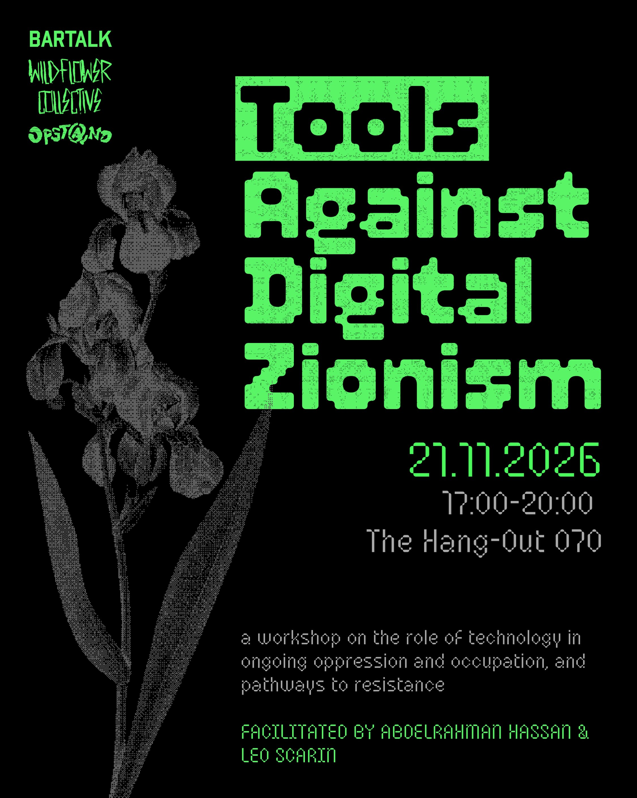
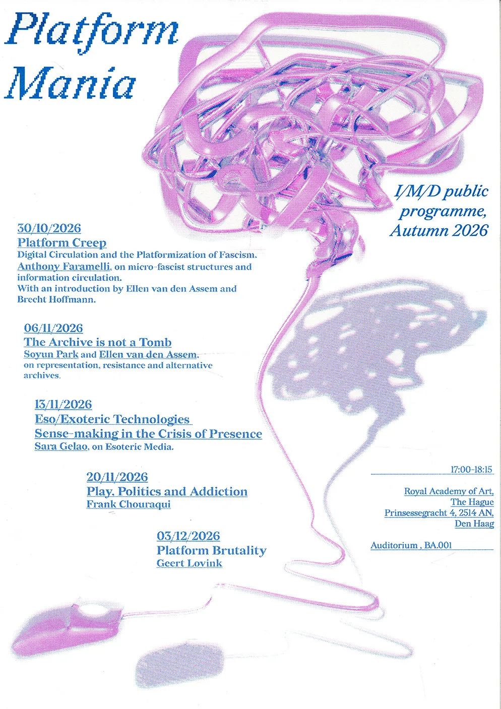

# November 2026

## Tools Against Digital Zionism

Abdo Hassan and I are hosting [Tools Against Digital Zionism](https://www.instagram.com/p/De1bKwRDRDJ/?img_index=1) at the [Hang-Out 070](https://www.thehang-out070.nl) in The Hague

## Hello, Goodbye
For a few weeks now, [Ko de Beer](kodebeer.nl), [Sunjoo Lee](sunjoolee.com) and I have been organising [Hello, Goodbye](https://www.instagram.com/p/DeLtJuZDpdg/?img_index=1): a series of workshops and meetups aimed at learning to unuse big tech. Next one is November 12th at [Kunstgreep95](https://kg95.nl).

## Platform Mania

'''Watch this space''': my colleague Ellen Van den Assem curated [Platform Mania](https://www.kabk.nl/agenda/i-m-d-presents-series-of-lectures-platform-mania), the official Interactive / Media / Design public program at KABK! It's a series of lectures every Friday at KABK. It informs our effort to build a platform in I/M/D, to unlearn big tech and to learn our tech :)

You can find the current w.i.p. platform I am coding at [imd.page](https://imd.page)